<p align="center">
  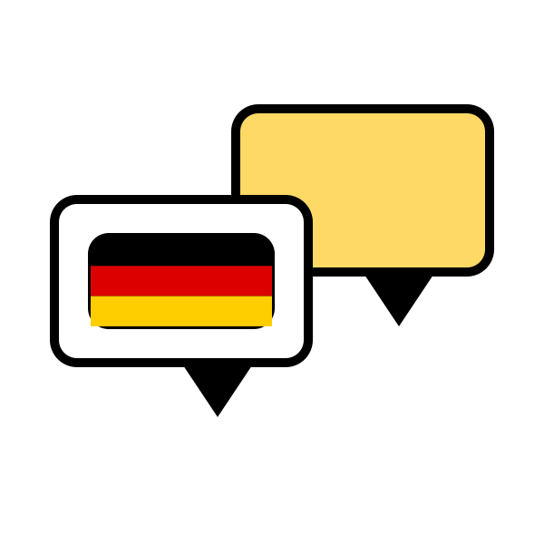
</p>

<h1 align="center">Almanca Konuş</h1>

<p align="center">
  <strong>A warm, bilingual (Turkish ⇄ German) website for a German speaking club:<br/>
  lessons, a blog, a German–Turkish dictionary, online placement exams and an admin panel anyone can use.</strong>
</p>

<p align="center">
  <a href="https://www.almanca-konus.com/"></a>
  
  
  
  
  <a href="LICENSE"></a>
</p>

<p align="center">
  <a href="#-features">Features</a> ·
  <a href="#-getting-started">Getting started</a> ·
  <a href="#-configuration">Configuration</a> ·
  <a href="docs/DESIGN.md">Design notes</a> ·
  <a href="CONTRIBUTING.md">Contributing</a> ·
  <a href="#-using-this-project">Using this project</a>
</p>

<p align="center">
  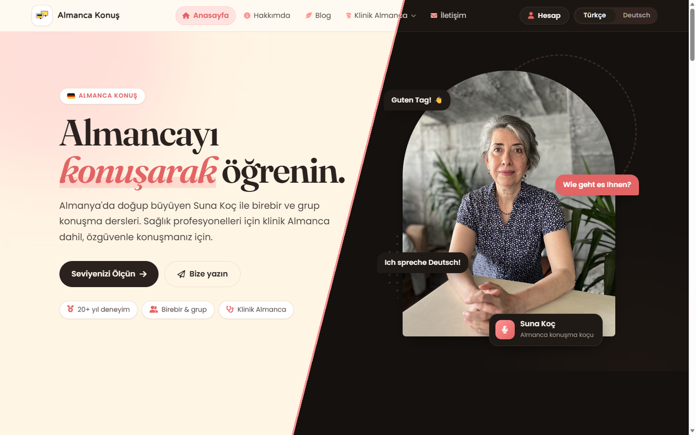
</p>

---

## 💛 The story

I built Almanca Konuş for my mother, **Suna Koç**. She grew up in Bremen, German is her mother tongue, and she
teaches Turkish speakers to actually *speak* German, in small groups and one-to-one, including clinical German
for doctors and nurses who move to Germany.

She needed more than a brochure: a place where students can take a placement test, look up a word, read her
posts and get in touch, and an admin panel she can run **on her own, without any computer knowledge**.
Every screen in the panel explains, step by step, what to do next.

If this project is useful to you, you are welcome to use it. Please [register your use](#-using-this-project);
it's free, and it lets me see who it helps.

---

## ✨ Features

### A home page with real depth

The highlights slider draws its images on a **WebGL plane** and changes slides with a liquid, noise-driven
wipe. A small **3D still life** (a speech bubble with a medical cross, a typing bubble, a capsule) floats
behind the frosted clinical-German cards and leans toward the mouse. Without WebGL, with "reduce motion" or with
"save data" on, the page falls back to CSS and still frames.

<table>
  <tr>
    <td width="50%"></td>
    <td width="50%"></td>
  </tr>
  <tr>
    <td align="center"><sub>Shader transition: simplex noise, a coral edge and a slight colour split</sub></td>
    <td align="center"><sub>Three.js scene placed in CSS pixels, so it follows the page layout</sub></td>
  </tr>
</table>

### A German ⇄ Turkish dictionary that asks the right sources in order

1. **Our own dictionary first.** Words the teacher prepared in the admin panel, with meaning, example sentence,
   pronunciation, synonyms and origin. `Hand`, `die Hand` and `DIE hand` all find the same entry.
2. **Then DeepL.** German is translated into Turkish, Turkish into German. Single words that DeepL detects as
   English or Dutch (`Kind`, `Hand`) are read as German.
3. **Then PONS**, the German–Turkish dictionary, with the different meanings of the word.

Answers from DeepL and PONS are cached, so a popular word costs one API call per 12 hours. Each visitor can run
15 searches a minute. A **Listen** button reads the German word aloud with the browser's own voice, and
**ä ö ü ß** buttons help on Turkish keyboards.

<p align="center"></p>

### An online exam centre that works like a university exam

<table>
  <tr>
    <td width="50%"></td>
    <td width="50%">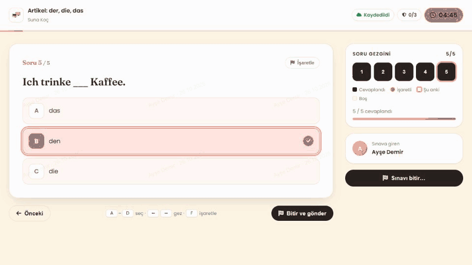</td>
  </tr>
</table>

- **The server owns the clock.** The time starts when the student clicks Start. Reloading doesn't reset it, and
  at zero the answers are submitted automatically.
- **Nothing gets lost.** Answers are saved continuously and also kept on the device, so a reload or a dropped
  connection costs nothing.
- **Exam rules.** The exam runs in fullscreen. Leaving it, switching tabs, copying, pasting or printing each
  count as a violation, with a warning every time. The third violation ends the exam.
- **A calm exam room.** Question navigator, flags, A–D and ←/→ shortcuts, a review screen before submitting, the
  student's name as a faint watermark, and warnings at 5 minutes and 1 minute.
- **Fair order.** Questions and answers are shuffled per attempt with a seeded Fisher–Yates shuffle, so a reload
  shows the same order.
- **Results** with a score ring, a correct/wrong/empty breakdown, an answer key and confetti at 80 %+.

| Lobby | Exam room | Result |
|:---:|:---:|:---:|
| 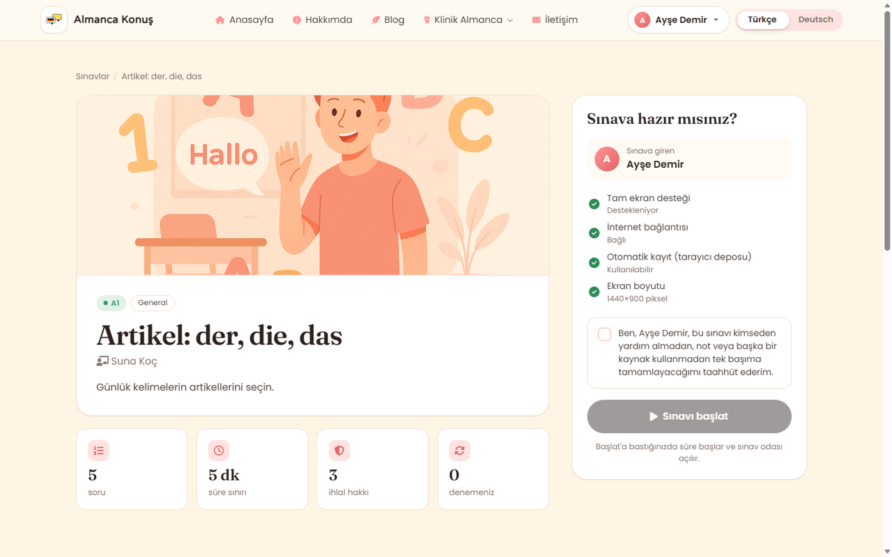 | 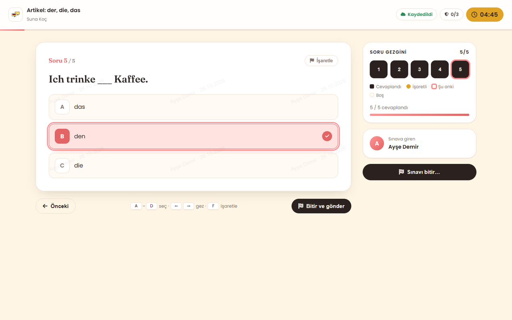 | 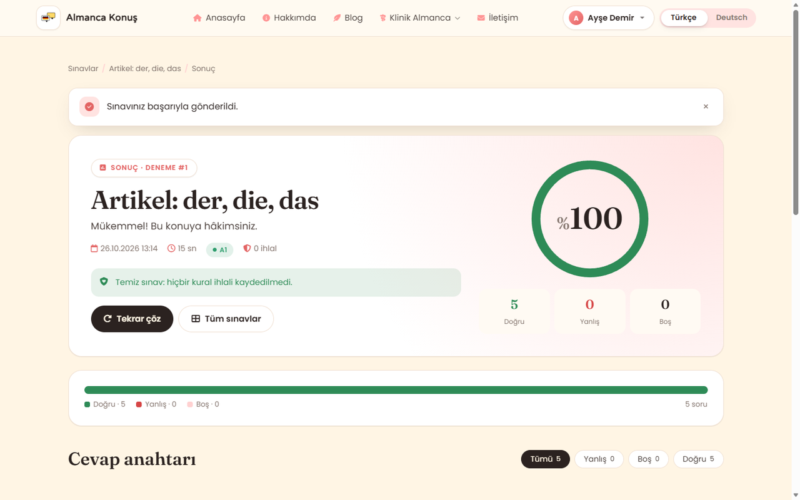 |

### An admin panel for someone who has never used one

Large buttons, plain words and a yellow **"What do I do here?"** box with numbered steps on every page. Deleting
always asks first and explains what will happen. Forms warn before you leave unsaved changes. Light and dark
themes, in Turkish or German.

<table>
  <tr>
    <td width="50%"></td>
    <td width="50%">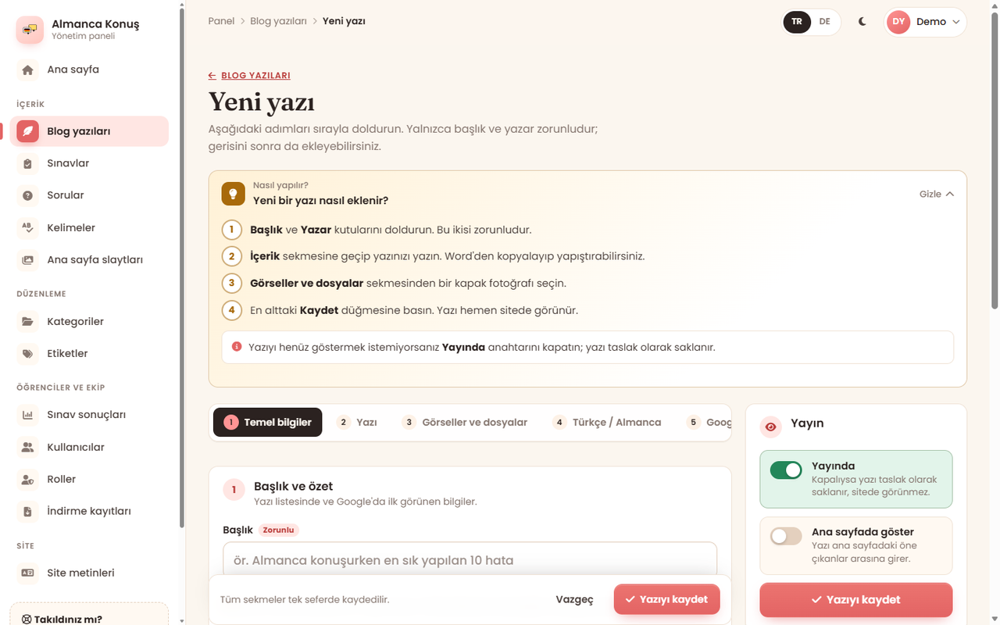</td>
  </tr>
  <tr>
    <td width="50%">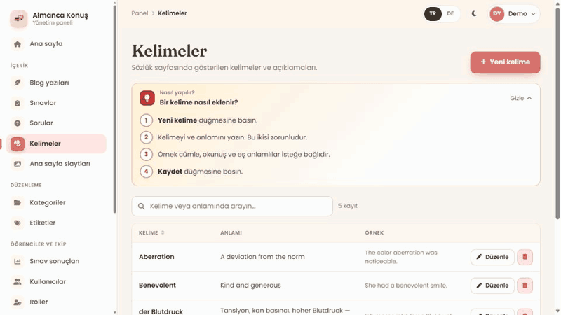</td>
    <td width="50%">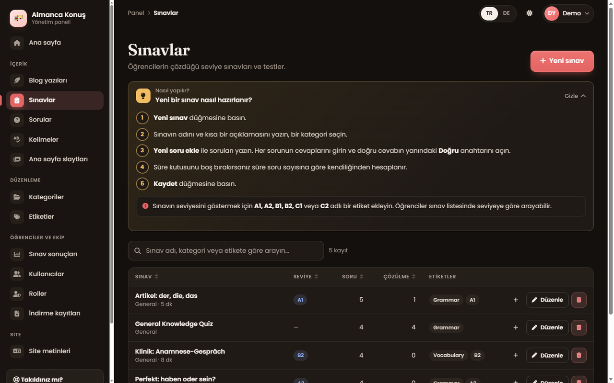</td>
  </tr>
</table>

What can be managed: blog posts (rich-text editor, cover image, attachments, SEO checklist, Turkish and German
versions), quizzes and questions (images, audio, YouTube), dictionary words, home page slides, categories, tags,
users and roles, download logs and every site text in both languages. **Exam results update live** over SignalR,
with filters and Excel/PDF export.

<p align="center">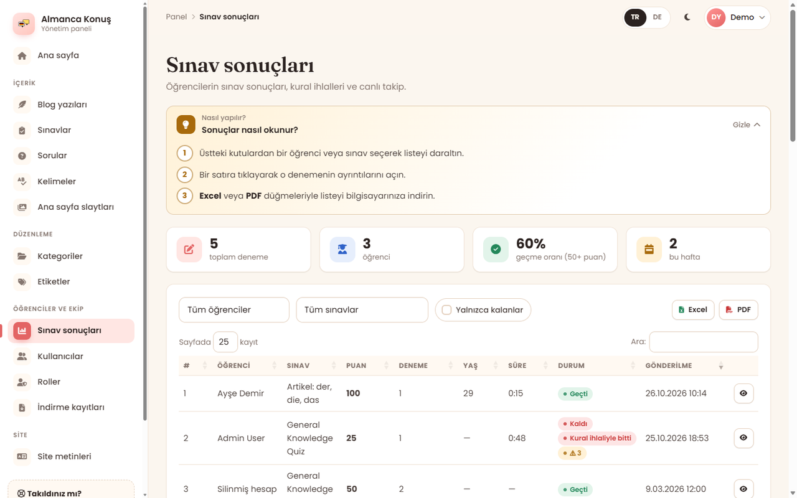</p>

### …and the rest of the site

<table>
  <tr>
    <td width="50%"></td>
    <td width="50%">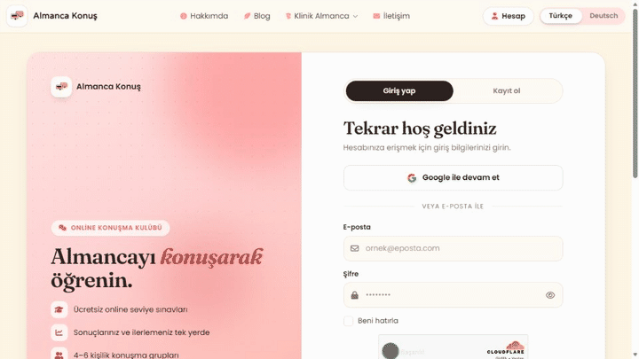</td>
  </tr>
  <tr>
    <td align="center"><sub>About page: a guided FAQ chat that hands off to WhatsApp</sub></td>
    <td align="center"><sub>Login: balloons drift and lean toward the pointer</sub></td>
  </tr>
  <tr>
    <td width="50%">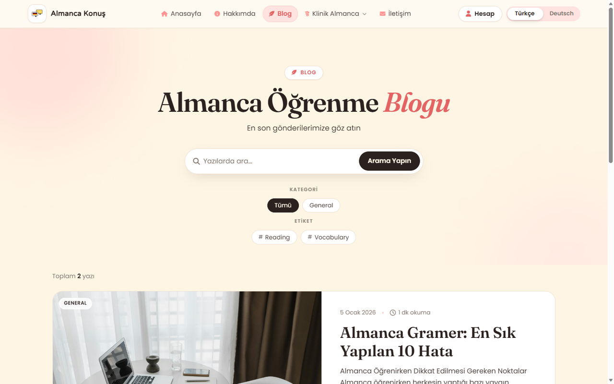</td>
    <td width="50%">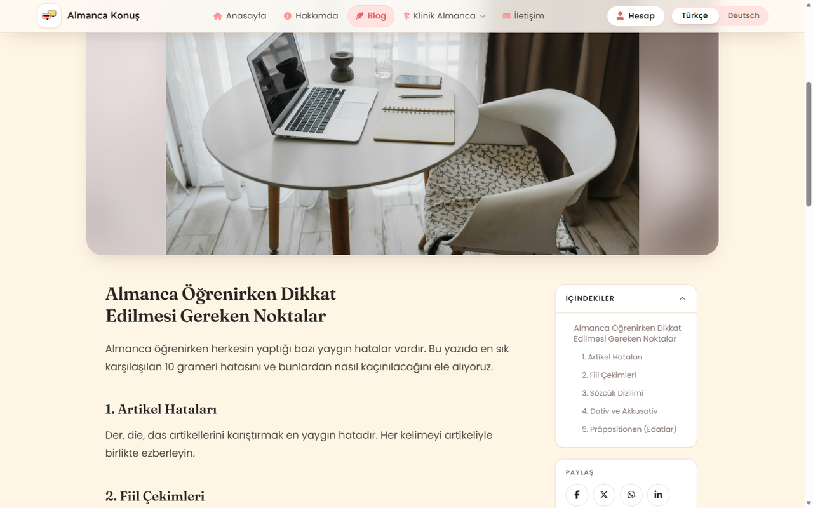</td>
  </tr>
</table>

- **Bilingual by design**: Turkish and German URLs (`/sozluk` ⇄ `/woerterbuch`), `hreflang`, a sitemap and
  structured data (FAQ, articles).
- **Phones first**: every page is tested at 390 px wide, without horizontal scrolling.
- **Accessible**: keyboard paths, visible focus, `aria-live` updates, honours *reduce motion*.
- **Accounts**: email sign-up with confirmation, Google sign-in, Cloudflare Turnstile against bots, a personal
  page with scores and progress.

<p align="center">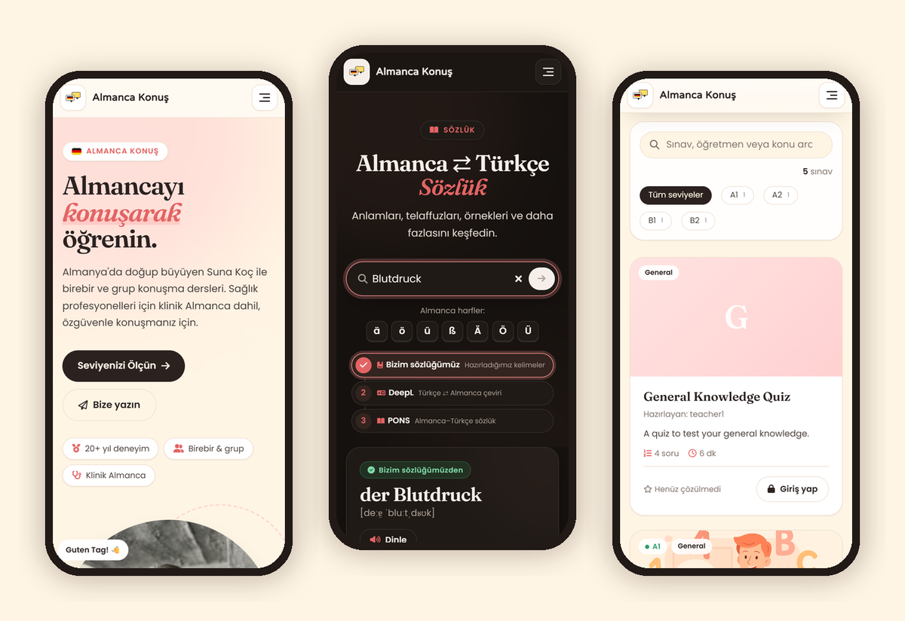</p>

---

## 🧱 Tech stack

| Layer | Technology |
|---|---|
| Backend | ASP.NET Core MVC on **.NET 10**, C#, Razor views and view components |
| Data | SQL Server, **Entity Framework Core 10** (two contexts: content and identity), repository + unit of work |
| Auth | ASP.NET Core Identity (roles: Root, Admin, Teacher, User), Google sign-in, Cloudflare Turnstile |
| Realtime | SignalR (live exam results) |
| Front end | Hand-written CSS with design tokens (light/dark), vanilla JavaScript, Bootstrap 5 (grid and base components) |
| 3D / motion | **Three.js r174** (custom GLSL shaders, physical materials), IntersectionObserver, CSS animations |
| Editors | CKEditor 5 (blog), small rich-text fields in the admin panel |
| Images | SkiaSharp: uploaded slider photos are resized automatically (1920 / 1200 / 600 px) |
| Services | DeepL API, PONS dictionary API, SMTP mail |
| Charts & export | Chart.js, DataTables, EPPlus / SheetJS (Excel), jsPDF (PDF) |
| Delivery | GitHub Actions → Plesk (IIS) over FTP, with a database backup before migrations |

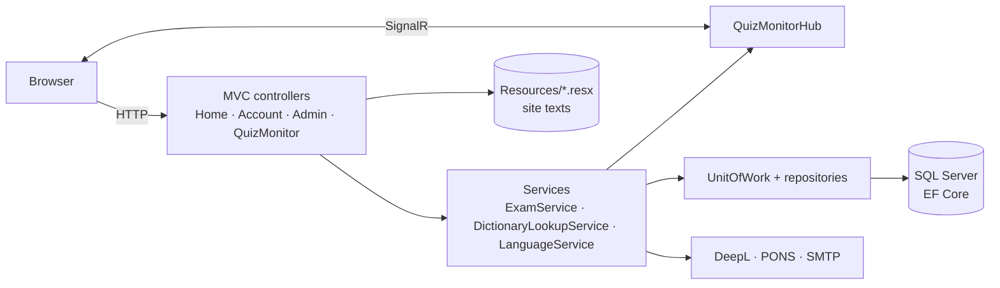

---

## 🚀 Getting started

### Prerequisites

- [.NET 10 SDK](https://dotnet.microsoft.com/download/dotnet/10.0)
- SQL Server (Express, Developer or LocalDB)
- Optional: API keys for DeepL and PONS (the dictionary still works with your own words without them)

### 1. Clone

```bash
git clone https://github.com/mert-turkgil/SpeakingClub.git
cd SpeakingClub
```

### 2. Configure

Create `appsettings.Development.json` next to `appsettings.json` (it is git-ignored, so your secrets stay on
your machine), or use `dotnet user-secrets`:

```json
{
  "ConnectionStrings": {
    "DefaultConnection": "Server=(localdb)\\MSSQLLocalDB;Database=AlmancaKonus;Trusted_Connection=True;TrustServerCertificate=True"
  },
  "Data": {
    "Roles": [ "Root", "Admin", "Teacher", "User" ],
    "Users": [
      {
        "username": "admin",
        "password": "Change-Me-2026",
        "email": "admin@example.com",
        "role": "Admin",
        "firstName": "Your",
        "lastName": "Name"
      }
    ]
  },
  "DeepL": { "ApiKey": "your-key:fx" },
  "Pons": { "ApiKey": "your-key" }
}
```

### 3. Run

```bash
dotnet run --launch-profile https
```

Open <https://localhost:7001>. In Development the app **applies the database migrations itself** and creates the
roles and users from `Data:Users`. Sign in with that user and open `/Admin`.

---

## ⚙️ Configuration

| Key | Needed for |
|---|---|
| `ConnectionStrings:DefaultConnection` | Everything (SQL Server) |
| `Data:Roles`, `Data:Users` | First start: the roles and the first admin account |
| `DeepL:ApiKey` | Dictionary step 2. Free keys end in `:fx` and use `api-free.deepl.com` automatically |
| `Pons:ApiKey` | Dictionary step 3 |
| `EmailSender:*` (`SMTPMail`, `Port`, `Username`, `Password`, `FromEmail`, `FromName`, `ReplyToEmail`) | Sign-up confirmation emails and the contact form |
| `Turnstile:SiteKey`, `Turnstile:SecretKey` | Bot protection on sign-up, login and contact |
| `Authentication:Google:ClientId`, `…:ClientSecret` | "Continue with Google" (optional) |
| `License:CKEditor` | Blog editor license key ([CKEditor licensing](https://ckeditor.com/pricing/)) |
| `ContentSecurityPolicy` | The site's CSP header |

Leaving `DeepL` or `Pons` empty simply skips that step.

---

## 🗂️ Project structure

```text
Controllers/         Home (public site), Account (sign-in, exams, profile), Admin, QuizMonitor, Sitemap
Data/                EF Core contexts, repositories, unit of work, migrations (two contexts)
Entity/              Database entities (Blog, Quiz, Question, Word, Slide, …)
Hubs/                SignalR hub for live exam results
Identity/            User, identity context, seeding
Models/              View models (incl. AdminNav: every admin section and its step-by-step guide)
Resources/           Site texts in Turkish and German (.resx, editable in the admin panel)
Services/            Exam rules and grading, dictionary lookup (DB → DeepL → PONS), mail, localization
ViewComponents/      Admin lists, language selector, slides
Views/               Razor views (Home, Account, Admin, Shared layouts)
wwwroot/css|js/      Hand-written styles and scripts, one pair per area (home, quiz, exam, admin, …)
docs/                Design notes (DESIGN.md) and the README images
.github/             CI, deployment to Plesk, database backup tool, restore guide
```

---

## 📦 Deployment

Every push to `main` runs [`.github/workflows/plesk-deploy.yml`](.github/workflows/plesk-deploy.yml):

1. Builds and publishes the app and writes `appsettings.Production.json` from GitHub Secrets.
2. Checks the production database for pending EF migrations.
3. If there are any, **backs up the database first**, then applies them.
4. Takes the site offline for a moment (`app_offline.htm`), uploads, and brings it back.
5. Smoke-tests `/health` and the home page.

How to restore a backup: [`.github/deploy/RESTORE.md`](.github/deploy/RESTORE.md).

---

## 🎨 Design and engineering notes

How the shader slider, the 3D scene, the design tokens, dark mode, the motion system, the exam room and the admin
panel are built, with code: **[docs/DESIGN.md](docs/DESIGN.md)**.

---

## 🤝 Contributing

Bug reports, translations (Turkish/German), accessibility fixes and features are all welcome.
Please read **[CONTRIBUTING.md](CONTRIBUTING.md)** first. It covers the setup, the conventions and what a good
pull request looks like.

---

## 📄 Using this project

The code is **free to use, modify and deploy**, including for paid lessons, under the
[Almanca Konuş Source License](LICENSE). In short:

| ✅ You may | 📝 You must | 🚫 Not included |
|---|---|---|
| Use, copy and change the code | **Register your use** ([one short form](https://github.com/mert-turkgil/SpeakingClub/issues/new?template=usage-registration.yml)) before others can reach your copy | The Almanca Konuş name and logo |
| Run it for your own school, club or lessons | Keep the copyright notice and the LICENSE file | Photos of people, teaching content, quiz questions, blog posts |
| Charge for your own teaching | Show a small "Built with Almanca Konuş" credit | Presenting your site as the original |

The registration only asks who you are, how to reach you and where the site runs. You can also send it
privately instead of in a public issue. This is a source-available license, not an OSI open-source license.
Read the full [LICENSE](LICENSE) for the exact terms.

---

## 🙏 Acknowledgements

[Three.js](https://threejs.org/) · simplex noise by Ian McEwan / Ashima Arts · [CKEditor 5](https://ckeditor.com/) ·
[DeepL](https://www.deepl.com/) · [PONS](https://www.pons.com/) · [Chart.js](https://www.chartjs.org/) ·
[Font Awesome](https://fontawesome.com/) · [Fraunces](https://fonts.google.com/specimen/Fraunces) and
[Poppins](https://fonts.google.com/specimen/Poppins) on Google Fonts · the theme toggle is adapted from
[Uiverse.io](https://uiverse.io/).

<p align="center">
  Made with care in Turkish and German by <a href="https://github.com/mert-turkgil">Mert Türkgil</a>, for Suna Koç and her students.
</p>
