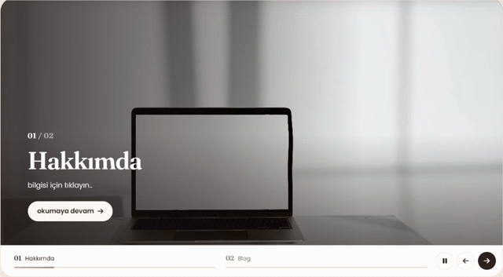
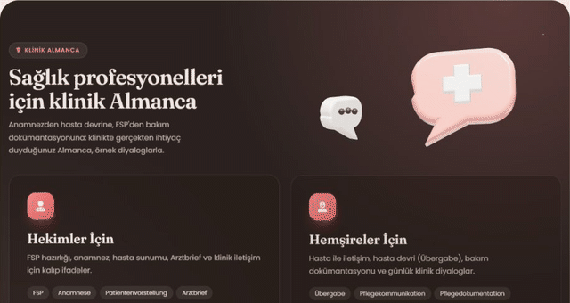
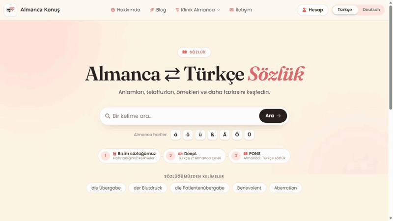
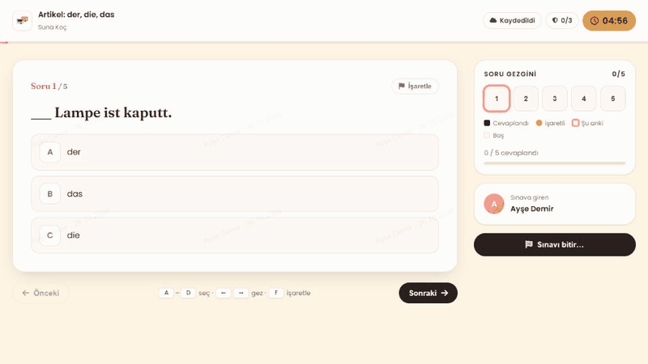
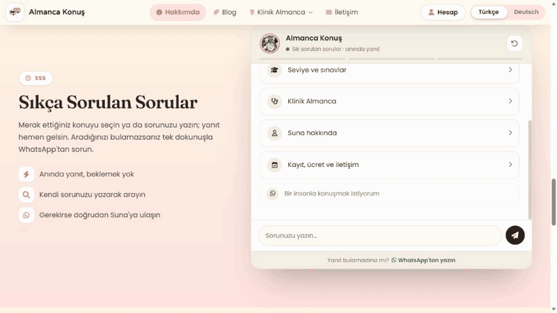
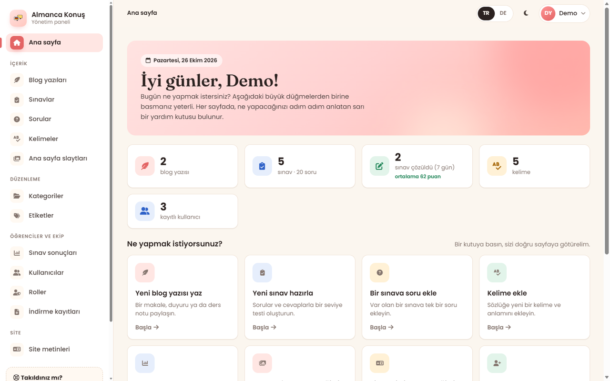

# Design & Engineering Notes

How Almanca Konuş looks the way it does, and how the parts that move actually work. This is a reference: each
section explains the idea, shows the real code (trimmed, from the files named in the heading) and lists the
decisions behind it, so you can change things later without breaking them.

> **Where things live:** styles in `wwwroot/css/`, scripts in `wwwroot/js/`, one pair per area. `blog.css` holds
> the shared design tokens for the public site, `admin.css` the tokens for the admin panel.
>
> **Designing something new?** Start with the [DESIGN.md](../DESIGN.md) in the repository root: the tokens, the
> components and the voice (a personal teacher's site, not a company) in the DESIGN.md format that people and AI
> design tools can follow. This file explains how it is built.

**Contents**

1. [Design principles](#1-design-principles)
2. [Design tokens](#2-design-tokens)
3. [Dark mode](#3-dark-mode)
4. [Typography and fluid layout](#4-typography-and-fluid-layout)
5. [Motion system](#5-motion-system)
6. [Pointer effects with CSS variables](#6-pointer-effects-with-css-variables)
7. [Three.js: how it is loaded](#7-threejs-how-it-is-loaded)
8. [Three.js: the WebGL slider (shader transition)](#8-threejs-the-webgl-slider-shader-transition)
9. [Three.js: the 3D clinical band](#9-threejs-the-3d-clinical-band)
10. [Glass, depth and shadows](#10-glass-depth-and-shadows)
11. [Small components worth knowing](#11-small-components-worth-knowing)
12. [The dictionary page](#12-the-dictionary-page)
13. [The exam room](#13-the-exam-room)
14. [The About page concierge](#14-the-about-page-concierge)
15. [The admin panel design system](#15-the-admin-panel-design-system)
16. [Accessibility checklist](#16-accessibility-checklist)
17. [Performance checklist](#17-performance-checklist)
18. [Recipes](#18-recipes)
19. [File map](#19-file-map)

---

## 1. Design principles

The site is for a teacher and her students, many of whom are adults who find computers stressful. Everything
follows from that:

| Principle | What it means in practice |
|---|---|
| **Warm, not corporate** | A cream "paper" canvas (`#FFF5E4`), a coral accent (`#FF9494` / `#E36464`), soft blurred blobs, rounded shapes, a serif for headlines |
| **Calm motion** | Things rise gently into place and drift slowly. Nothing flashes or bounces for attention, and everything stops for *reduce motion* |
| **Depth where it explains** | The 3D scene and the shader slider are decoration, so they load last, only when visible, and never block reading |
| **Progressive enhancement** | Every page works as plain HTML and CSS. JavaScript adds behaviour, and WebGL adds polish on top of that |
| **Two languages, equal** | Turkish and German everywhere, including URLs, admin texts, error messages and alt texts |
| **Plain words in the admin** | Every admin page says what it is for and what to do, in numbered steps |

The brand colours come from the original logo palette: `#FFF5E4` (light peach), `#FFE3E1` (blush), `#FFD1D1`
(pink), `#FF9494` (coral). The redesign added a deeper coral `#E36464` for contrast and a warm near-black ink
`#2B2220` instead of pure black.

---

## 2. Design tokens

*File: `wwwroot/css/blog.css` → "1. TOKENS"*

All public pages share one set of CSS custom properties. They are declared on the page root class, not on
`:root`, so the redesigned pages can live next to older pages without leaking into them:

```css
.blog-page,
.home-page,
.quiz-page,
.site-page {
  --bp-canvas: #FFF5E4;          /* page background: cream paper */
  --bp-surface: #FFFFFF;         /* cards */
  --bp-surface-soft: #FFFAF3;    /* quiet panels, quotes */
  --bp-ink: #2B2220;             /* headings */
  --bp-body: #4A3F3B;            /* text */
  --bp-muted: #85766F;           /* meta, labels */
  --bp-hairline: #F0E0D2;        /* borders */
  --bp-blush: #FFE3E1;
  --bp-pink: #FFD1D1;
  --bp-coral: #FF9494;
  --bp-coral-deep: #E36464;
  --bp-link: #C2413F;            /* 4.7:1 on the cream canvas */
  --bp-highlight: rgba(255, 148, 148, 0.28);

  --bp-shadow-1: 0 1px 2px rgba(43, 34, 32, 0.05), 0 1px 1px rgba(43, 34, 32, 0.03);
  --bp-shadow-2: 0 12px 32px -14px rgba(43, 34, 32, 0.22);
  --bp-shadow-3: 0 26px 50px -18px rgba(227, 100, 100, 0.38);   /* coral-tinted "lifted" shadow */

  --bp-radius-lg: 24px;  --bp-radius: 16px;  --bp-radius-sm: 10px;

  --bp-ease: cubic-bezier(0.22, 0.61, 0.36, 1);          /* soft ease-out for almost everything */
  --bp-ease-spring: cubic-bezier(0.34, 1.56, 0.64, 1);   /* small overshoot for icons and arrows */
  --bp-fast: 180ms;  --bp-med: 320ms;  --bp-slow: 700ms;

  --bp-serif: 'Fraunces', Georgia, 'Times New Roman', serif;
  --bp-sans: 'Poppins', system-ui, -apple-system, 'Segoe UI', Roboto, sans-serif;
}
```

**Rules of thumb**

- Components only ever use tokens (`color: var(--bp-ink)`), never raw hex values. That is what makes dark mode
  nearly free (next section).
- Three shadow levels: `1` for resting cards, `2` for floating things (search pill, dropdowns), `3` for hover
  ("lifted"). Level 3 is tinted coral, which makes hovered cards feel warm instead of grey.
- To build a new page on the system, give its root `class="site-page your-page"` and load `blog.css` before your
  page stylesheet ([recipe](#a-new-page-in-the-design-system)).

The admin panel has its own token set (`--a-*`, [section 15](#15-the-admin-panel-design-system)). It belongs
to the same family but is tuned for work: calmer surfaces and stronger status colours.

---

## 3. Dark mode

*Files: `Views/Shared/_Layout.cshtml`, `wwwroot/css/blog.css`, `wwwroot/css/dark-mode.css`*

**Technique: swap the tokens, not the components.** Dark mode redefines the same variables under
`html[data-bs-theme="dark"]`, so every component that uses tokens switches automatically:

```css
html[data-bs-theme="dark"] .site-page {
  --bp-canvas: #15110e;            /* warm near-black, not blue-grey */
  --bp-surface: #1f1a16;
  --bp-surface-soft: #251f1a;
  --bp-ink: #F6EFE9;
  --bp-body: #DCD2C9;
  --bp-muted: #AB9F95;
  --bp-hairline: rgba(255, 255, 255, 0.09);
  --bp-blush: #33241F;
  --bp-pink: #4A302C;
  --bp-link: #FFADAD;
  --bp-shadow-2: 0 12px 32px -14px rgba(0, 0, 0, 0.7);
}
```

Only effects that don't come from tokens need their own dark rule, for example the decorative blobs, which
are toned down so they don't glow:

```css
html[data-bs-theme="dark"] .bp-hero::before,
html[data-bs-theme="dark"] .bp-hero::after { opacity: 0.25; }
```

**No flash of the wrong theme.** The theme is applied by a tiny inline script at the very top of `<head>`,
before any CSS is parsed:

```html
<script>
  (function () {
    var t = localStorage.getItem('theme') || 'light';
    document.documentElement.setAttribute('data-bs-theme', t);
  })();
</script>
```

The attribute name `data-bs-theme` is Bootstrap 5.3's own, so Bootstrap components (dropdowns, modals, form
controls) switch too. The sun/moon toggles in the footer and the mobile menu share one handler that writes the
attribute, stores the choice and keeps every toggle in sync.

---

## 4. Typography and fluid layout

*Files: `blog.css`, `home.css`*

- **Two typefaces:** *Fraunces* (a soft, high-contrast serif with an italic) for headlines, *Poppins* for UI
  and body text. Emphasis in headlines uses the italic in coral: `Almancayı <em>konuşarak</em> öğrenin.`
- **Fluid sizes with `clamp()`:** type and spacing scale with the viewport between a minimum and a maximum, so
  there are very few breakpoints:

  ```css
  .hp-hero__title { font-size: clamp(2.7rem, 6.4vw, 4.75rem); line-height: 1.02; letter-spacing: -0.032em; text-wrap: balance; }
  .hp-section     { padding-top: clamp(4rem, 8vw, 6.5rem); }
  ```

  `text-wrap: balance` evens out the line lengths of multi-line headings, and the negative letter-spacing
  tightens large serif text, which looks loose at display sizes.
- **Container:** `width: min(1180px, 100% - 2rem)` gives a max width and a 1 rem gutter in one line.
- **Grids that need no media queries:**

  ```css
  .hp-features { display: grid; grid-template-columns: repeat(auto-fit, minmax(min(100%, 290px), 1fr)); gap: 1.5rem; }
  ```

  `min(100%, 290px)` stops the minimum from overflowing on very narrow phones.
- **No sideways scrolling, ever:** decorative elements that hang outside their box are clipped with
  `overflow-x: clip` on the page root (unlike `hidden`, `clip` doesn't create a scroll container, so
  `position: sticky` keeps working).
- **Animated highlighter under the hero word:** a background gradient that grows from 0 to full width:

  ```css
  .hp-hero__title em {
    background: linear-gradient(var(--bp-highlight), var(--bp-highlight)) 0 88% / 0 0.3em no-repeat;
    animation: hp-underline 0.9s var(--bp-ease) 0.7s forwards;
  }
  @keyframes hp-underline { to { background-size: 100% 0.3em; } }
  ```

---

## 5. Motion system

*Files: `blog.css` ("2. MOTION"), `blog.js` (`initReveal`)*

Three kinds of motion are used across the site, all built on the same easing and duration tokens.

### 5.1 Entrance: `.bp-enter` with a stagger variable

Elements above the fold rise into place when the page loads. The stagger is a CSS variable set inline, so the
order is visible in the markup:

```css
@keyframes bp-rise {
  from { opacity: 0; transform: translateY(18px); }
  to   { opacity: 1; transform: none; }
}
.bp-enter { animation: bp-rise var(--bp-slow) var(--bp-ease) both; animation-delay: var(--bp-delay, 0ms); }
```

```html
<span class="bp-eyebrow bp-enter">…</span>
<h1 class="bp-hero__title bp-enter" style="--bp-delay: 80ms">…</h1>
<p class="bp-hero__lead bp-enter" style="--bp-delay: 160ms">…</p>
```

### 5.2 Scroll reveal that is safe without JavaScript

Content further down fades up as it scrolls into view. The catch with most reveal effects is that content stays
invisible if the script fails. Here, elements are only hidden while `<html>` has the class `bp-js`, which each
page adds in `<head>`:

```html
<script>document.documentElement.classList.add('bp-js');</script>
```

```css
.bp-js .reveal {
  opacity: 0;
  transform: translateY(22px);
  transition: opacity var(--bp-slow) var(--bp-ease), transform var(--bp-slow) var(--bp-ease);
  transition-delay: var(--bp-delay, 0ms);
}
.bp-js .reveal.is-visible { opacity: 1; transform: none; }
```

```js
const observer = new IntersectionObserver((entries) => {
  entries.forEach((entry) => {
    if (!entry.isIntersecting) return;
    entry.target.classList.add('is-visible');
    observer.unobserve(entry.target);          // reveal once, then stop watching
  });
}, { rootMargin: '0px 0px -8% 0px', threshold: 0.08 });
```

Without `IntersectionObserver`, or with *reduce motion*, everything is shown at once.

> **Primary content is never `.reveal`.** A search result or the main card must be visible immediately, even in a
> full-page screenshot or when the page opens scrolled. Those use `.bp-enter` instead.

### 5.3 Ambient drift: blurred blobs

The soft coloured clouds behind heroes are two pseudo-elements with a large blur, drifting slowly out of phase:

```css
.bp-hero::before,
.bp-hero::after {
  content: "";
  position: absolute;
  border-radius: 50%;
  filter: blur(60px);
  opacity: 0.55;
  pointer-events: none;
  animation: bp-drift 16s ease-in-out infinite;
}
.bp-hero::after { animation-delay: -8s; }        /* negative delay = start halfway through */

@keyframes bp-drift {
  0%, 100% { transform: translate3d(0, 0, 0) scale(1); }
  50%      { transform: translate3d(2%, -3%, 0) scale(1.06); }
}
```

### 5.4 One switch for *reduce motion*

```css
@media (prefers-reduced-motion: reduce) {
  .site-page *, .site-page *::before, .site-page *::after {
    animation-duration: 1ms !important;
    animation-iteration-count: 1 !important;
    transition-duration: 1ms !important;
    scroll-behavior: auto !important;
  }
  .bp-js .reveal { opacity: 1; transform: none; }
}
```

`1ms` instead of `none` keeps `animationend` / `transitionend` events firing, so scripts that wait for them still
work. Scripts check the same media query before starting loops (slider autoplay, 3D animation, confetti).

---

## 6. Pointer effects with CSS variables

*Files: `home.css` + `home.js` (hero bubbles), `auth.css` + `auth.js` (login balloons), `blog.css` + `blog.js` (card glow)*

**Technique:** JavaScript only measures the pointer and writes two numbers into CSS variables. CSS turns them
into movement. That keeps the script tiny and the visuals in the stylesheet.

### 6.1 Hero speech bubbles and login balloons: parallax by depth

```js
// home.js: one write per animation frame, values from -0.5 to 0.5
hero.addEventListener('pointermove', (e) => {
  if (frame) return;
  frame = requestAnimationFrame(() => {
    frame = null;
    const r = visual.getBoundingClientRect();
    visual.style.setProperty('--px', ((e.clientX - r.left) / r.width - 0.5).toFixed(3));
    visual.style.setProperty('--py', ((e.clientY - r.top) / r.height - 0.5).toFixed(3));
  });
});
```

```css
.hp-bubble {
  --depth: 1;
  translate: calc(var(--px) * 18px * var(--depth)) calc(var(--py) * 18px * var(--depth));
  transition: translate 0.4s var(--bp-ease);
  animation: hp-pop 0.7s var(--bp-ease-spring) both, hp-float 6s ease-in-out infinite;
}
.hp-bubble--2 { --depth: -1.4; }   /* negative depth moves the other way: feels "in front" */
.hp-bubble--3 { --depth: 0.7; }
```

**Why `translate` and not `transform`:** the bubbles already float with a `transform` keyframe animation. The
individual `translate` property composes *on top of* `transform`, so the parallax and the float run at the same
time without fighting. The login balloons (`.auth__blob`) use exactly the same pattern with depths 26, −18 and
40, plus their own slow float keyframes.

The effect only runs for a fine pointer (`(hover: hover) and (pointer: fine)`) and without *reduce motion*;
touch devices get the plain float.

### 6.2 Card glow that follows the mouse

```js
document.addEventListener('pointermove', (e) => {
  const card = e.target.closest?.('.post-card, .qz-card');
  if (!card) return;
  const r = card.getBoundingClientRect();
  card.style.setProperty('--mx', (e.clientX - r.left) + 'px');
  card.style.setProperty('--my', (e.clientY - r.top) + 'px');
}, { passive: true });
```

```css
.post-card::after {
  background: radial-gradient(420px circle at var(--mx) var(--my), rgba(255, 148, 148, 0.12), transparent 45%);
}
```

One delegated listener serves every card on the page.

---

## 7. Three.js: how it is loaded

*Files: `Views/Home/Index.cshtml` (import map), `wwwroot/js/home-3d.js`*

Three.js (r174) is about 180 KB gzipped, which is too much to put in the way of a visitor who came to read. So
it is treated as optional, late-loading polish.

### 7.1 An import map with cache-busting

The home page maps the bare specifier `three` to the local build, with a content hash in the URL (the same thing
`asp-append-version` does for normal scripts):

```cshtml
@* "<!script>" opts out of ASP.NET's ScriptTagHelper, which takes over type="importmap" and drops the attribute. *@
<!script type="importmap">
{
  "imports": {
    "three": "@FileVersion.AddFileVersionToPath(Context.Request.PathBase, "/lib/three/build/three.module.min.js")",
    "/lib/three/build/three.core.min.js": "@FileVersion.AddFileVersionToPath(Context.Request.PathBase, "/lib/three/build/three.core.min.js")",
    "three/addons/": "/lib/three/examples/jsm/"
  }
}
</!script>
```

Two details matter here:

- **`<!script>`**: ASP.NET Core's tag helper rewrites `<script type="importmap">` and strips the `type`. The `!`
  opts this one element out of tag helpers.
- **The second entry**: `three.module.min.js` itself imports `./three.core.min.js`. Mapping that path too means
  both files carry the hash, so a browser never combines a new module with a stale core.

### 7.2 Gate, wait, then import

```js
const reduceMotion = matchMedia('(prefers-reduced-motion: reduce)').matches;
const saveData = !!(navigator.connection && navigator.connection.saveData);
const webglAvailable = (() => {
  try { const c = document.createElement('canvas'); return !!(c.getContext('webgl2') || c.getContext('webgl')); }
  catch { return false; }
})();

let threePromise = null;
const loadThree = () => (threePromise ??= import('three'));     // one download, shared by both scenes

function afterLoad(fn) {                                          // after the page has finished loading…
  const idle = window.requestIdleCallback || ((cb) => setTimeout(cb, 200));
  if (document.readyState === 'complete') idle(fn, { timeout: 2000 });
  else addEventListener('load', () => idle(fn, { timeout: 2000 }), { once: true });
}

function whenNear(el, fn) {                                       // …and only when a section is close to the viewport
  const io = new IntersectionObserver((entries) => {
    if (entries.some((e) => e.isIntersecting)) { io.disconnect(); fn(); }
  }, { rootMargin: '300px 0px' });
  io.observe(el);
}

if (webglAvailable && !saveData) {
  afterLoad(() => {
    whenNear(slider, () => initSlider(slider));
    whenNear(clinic, () => initClinic(clinic));
  });
}
```

### 7.3 Render only while someone can see it

```js
function animateWhileVisible(el, step) {
  let visible = false, raf = 0;
  const loop = (now) => { raf = requestAnimationFrame(loop); step(now); };
  const update = () => {
    const run = visible && !document.hidden;
    if (run && !raf) raf = requestAnimationFrame(loop);
    else if (!run && raf) { cancelAnimationFrame(raf); raf = 0; }
  };
  new IntersectionObserver(([entry]) => { visible = entry.isIntersecting; update(); }).observe(el);
  document.addEventListener('visibilitychange', update);
}
```

A scrolled-away scene or a background tab costs zero GPU time. With *reduce motion*, the 3D band renders single
still frames (on load and on resize) instead of a loop.

---

## 8. Three.js: the WebGL slider (shader transition)

*Files: `home-3d.js` → "1. Slider", `home.js` → `initSlider`, `home.css` → "Highlights slider"*

<p align="center"></p>

### 8.1 Division of work

- **`home.js` owns the slider**: which slide is active, tabs with progress, autoplay, swipe, arrow keys, ARIA. On
  every change it fires a DOM event:

  ```js
  slider.dispatchEvent(new CustomEvent('hp:slide', { detail: { from, to: index, direction } }));
  ```

- **CSS draws a fallback transition**: a `clip-path` wipe plus a slow zoom on the real `` elements.
- **`home-3d.js` only listens.** If WebGL starts, it adds `.has-webgl` to the slider, which hides the ``
  elements and shows the canvas. The images stay in the DOM as the texture source, for SEO and as the fallback.

```css
.hp-gl-slide__img { clip-path: inset(0 0 0 100%); transform: scale(1.12); transition: clip-path 1.1s var(--bp-ease), transform 1.1s var(--bp-ease); }
.hp-gl-slide.is-active .hp-gl-slide__img { clip-path: inset(0); transform: scale(1); transition: clip-path 1.1s var(--bp-ease), transform 7.5s linear; }
.has-webgl .hp-gl-slide__img { visibility: hidden; }
.has-webgl .hp-gl-slider__canvas { opacity: 1; }   /* the first WebGL frame matches the : no flash */
```

### 8.2 A full-screen quad without a real camera

There is no 3D scene here, just one rectangle that covers the canvas, and a fragment shader that decides the
colour of every pixel. The vertex shader writes clip-space coordinates directly, so the camera is irrelevant:

```js
const scene = new THREE.Scene();
const camera = new THREE.Camera();                                  // identity, never moved
scene.add(new THREE.Mesh(
  new THREE.PlaneGeometry(2, 2),                                    // -1…1 = the whole viewport
  new THREE.ShaderMaterial({ uniforms, vertexShader: SLIDER_VERTEX, fragmentShader: SLIDER_FRAGMENT, depthTest: false, depthWrite: false })
));
```

```glsl
varying vec2 vUv;
void main() {
    vUv = uv;
    gl_Position = vec4(position.xy, 0.0, 1.0);
}
```

### 8.3 Textures from the image the browser already chose

```js
loader.load(img.currentSrc || img.src, (texture) => {
  texture.minFilter = THREE.LinearFilter;   // no mipmaps: the image is shown at about its own size
  texture.magFilter = THREE.LinearFilter;
  texture.generateMipmaps = false;
  resolve(texture);
});
```

`currentSrc` is the file the browser picked from `srcset` for this screen (600w, 1200w or full), so phones don't
download a desktop-size texture. The next slide's texture is preloaded as soon as a slide is shown.

**Colour management:** `renderer.outputColorSpace = THREE.LinearSRGBColorSpace`. The textures are sampled and
written unchanged (sRGB in, sRGB out), so the canvas looks exactly like the `` it replaces. Leaving the
default would apply an extra sRGB conversion and wash the photos out.

### 8.4 `object-fit: cover` in the shader

```glsl
// uRes = canvas size in pixels, size = image size; zoom > 1 zooms in around the centre
vec2 cover(vec2 uv, vec2 size, float zoom) {
    float rs = uRes.x / uRes.y;          // screen aspect
    float ri = size.x / size.y;          // image aspect
    vec2 s = vec2(min(rs / ri, 1.0), min(ri / rs, 1.0));
    return (uv - 0.5) * s / zoom + 0.5;
}
```

The `zoom` argument gives the slow "Ken Burns" push-in: JavaScript grows `uZoomA` from 1.0 to 1.06 over the time
a slide is shown.

### 8.5 The liquid wipe

The core idea: instead of revealing the new image along a straight line, reveal it along a **noisy field**.

```glsl
// 1) A field in 0…1: simplex noise mixed with a sweep in the slide direction
float n = snoise(uv * 2.2 + vec2(uTime * 0.05, 0.0)) * 0.5 + 0.5;   // slowly moving noise
float sweep = uDir > 0.0 ? uv.x : 1.0 - uv.x;                       // left→right or right→left
float field = mix(n, sweep, 0.55);                                   // 55 % direction, 45 % liquid

// 2) A soft threshold that moves through the field as progress goes 0 → 1
float w = 0.22;                                      // edge softness
float p = uProgress;
float m = smoothstep(field - w, field, p * (1.0 + w) - w);
//                                     └ remapped so that p = 0 is fully old and p = 1 fully new
```

`m` is the mask: 0 shows the old image, 1 the new one. Because `field` varies with the noise, the boundary is an
organic, flowing edge rather than a line.

Three extra touches make it feel physical:

```glsl
// 3) Displacement: the old image is pushed away, the new one settles into place
vec2 push = vec2(uDir * 0.08, 0.03) * (n - 0.5);
vec3 a = texture2D(uTexA, cover(uv + push * p * 2.0, uSizeA, uZoomA)).rgb;
vec2 uvB = cover(uv - push * (1.0 - p) * 2.0, uSizeB, uZoomB);

// 4) A small RGB split on the incoming image, strongest mid-transition: (1-p)·p peaks at p = 0.5
float shift = (1.0 - p) * p * 0.015 * uDir;
vec3 b = vec3(texture2D(uTexB, uvB + vec2(shift, 0.0)).r,
              texture2D(uTexB, uvB).g,
              texture2D(uTexB, uvB - vec2(shift, 0.0)).b);

vec3 color = mix(a, b, m);

// 5) A coral glow on the edge: m·(1-m)·4 is 1 exactly on the boundary and 0 elsewhere
float edge = m * (1.0 - m) * 4.0;
color += vec3(1.0, 0.58, 0.55) * edge * 0.28 * step(0.001, p) * step(p, 0.999);
```

The noise is the classic 2D simplex noise by Ian McEwan / Ashima Arts (MIT), pasted into the shader.

### 8.6 Ripple around the pointer

```glsl
vec2 d = uv - uMouse;
d.x *= uRes.x / uRes.y;                                    // keep the rings round on wide screens
float dist = length(d);
float wave = sin(dist * 28.0 - uTime * 3.0) * exp(-dist * 5.0) * 0.006 * uHover;
uv += (dist > 0.0001 ? d / dist : vec2(0.0)) * wave;       // push pixels outward along the radius
uv += (uMouse - 0.5) * 0.012 * uHover;                     // and a hint of parallax
```

A damped sine wave: `sin(...)` makes the rings, `exp(-dist * 5.0)` fades them with distance, `uTime` makes them
travel outward. On the JavaScript side the uniforms are eased every frame, so the ripple glides in and out:

```js
uniforms.uMouse.value.lerp(pointer, 0.08);
uniforms.uHover.value += ((reduceMotion ? 0 : hover) - uniforms.uHover.value) * 0.06;
```

### 8.7 Driving the transition

```js
slider.addEventListener('hp:slide', async ({ detail: { to, direction } }) => {
  requested = to;
  const texture = await load(to);
  if (requested !== to) return;              // the user clicked again while this was loading
  if (transition) finish();                  // jump the running transition to its end
  uniforms.uTexB.value = texture;
  uniforms.uSizeB.value.copy(sizeOf(texture));
  uniforms.uDir.value = direction < 0 ? -1 : 1;
  transition = { start: performance.now(), duration: reduceMotion ? 450 : 1600, to };
});

// every frame
const p = clamp01((now - transition.start) / transition.duration);
uniforms.uProgress.value = easeInOutCubic(p);
if (p >= 1) finish();                        // B becomes A, progress back to 0
```

**Tuning knobs:** `w` (edge softness), the `0.55` mix (more = straighter wipe), `2.2` (noise scale; higher =
smaller blobs), the `duration`, and the glow colour.

### 8.8 Autoplay that respects people

`home.js` advances the slide only when *all* of these are true: the user hasn't paused it, the mouse isn't over
it, keyboard focus isn't inside it (checked with `:focus-visible`, so a mouse click on "next" doesn't pause it),
the slider is at least 35 % visible, and the tab is visible. With *reduce motion* there is no autoplay at all.
Each tab shows its progress through a CSS variable:

```css
.hp-gl-tab__progress > span { transform: scaleX(var(--p, 0)); transform-origin: left; }
```

Slide titles reveal word by word: Razor wraps each word in `<span class="w"><span style="--wi: n">`, and CSS
delays each word by `calc(0.35s + var(--wi) * 0.07s)`.

---

## 9. Three.js: the 3D clinical band

*Files: `home-3d.js` → "2. Clinical band", `home.css` → "Dark bands"*

<p align="center"></p>

A small still life of medical and conversation symbols floats behind the "Clinical German" cards. It is built
entirely from code: no model files to download.

### 9.1 Renderer, light and materials

```js
renderer = new THREE.WebGLRenderer({ antialias: true, alpha: true, powerPreference: 'high-performance' });
renderer.setPixelRatio(Math.min(devicePixelRatio || 1, 1.75));   // sharp enough, much cheaper than 3×
renderer.outputColorSpace = THREE.SRGBColorSpace;
renderer.toneMapping = THREE.ACESFilmicToneMapping;               // filmic highlights, no clipped whites
renderer.setClearColor(0x000000, 0);                              // transparent: the CSS band shows through

// Image-based lighting without an HDR file: a procedural room, pre-filtered for PBR reflections
const pmrem = new THREE.PMREMGenerator(renderer);
scene.environment = pmrem.fromScene(new RoomEnvironment(), 0.04).texture;

// A warm key light and a coral rim light so the shapes read on the dark band
const key = new THREE.DirectionalLight(0xfff1e6, 1.3);  key.position.set(-4, 6, 8);
const rim = new THREE.DirectionalLight(0xff9494, 2.4);  rim.position.set(6, -2, -6);
```

The materials are `MeshPhysicalMaterial` with **clearcoat**, a second glossy layer that gives the "glazed
ceramic / soft plastic" look, and on the coral bubble a pink **sheen**, which adds a velvety rim:

```js
coral: new THREE.MeshPhysicalMaterial({ color: 0xff8f87, roughness: 0.32, clearcoat: 1, clearcoatRoughness: 0.12, sheen: 0.5, sheenColor: new THREE.Color(0xffd1d1) }),
```

### 9.2 Procedural geometry

**Speech bubble:** a 2D rounded rectangle with a tail, drawn with `THREE.Shape`, then extruded with a bevel:

```js
const bubbleGeometry = (w, h, r, tail) => {
  const s = new THREE.Shape();
  const x = -w / 2, y = -h / 2;
  s.moveTo(x + r, y);
  if (tail === 'left') { s.lineTo(x + r + 0.15, y); s.lineTo(x + r - 0.3, y - 0.75); s.lineTo(x + r + 0.95, y); }
  s.lineTo(x + w - r, y);
  s.absarc(x + w - r, y + r, r, -Math.PI / 2, 0, false);           // rounded corners with arcs
  s.lineTo(x + w, y + h - r);
  s.absarc(x + w - r, y + h - r, r, 0, Math.PI / 2, false);
  s.lineTo(x + r, y + h);
  s.absarc(x + r, y + h - r, r, Math.PI / 2, Math.PI, false);
  s.lineTo(x, y + r);
  s.absarc(x + r, y + r, r, Math.PI, Math.PI * 1.5, false);
  const g = new THREE.ExtrudeGeometry(s, { depth: 0.55, bevelEnabled: true, bevelThickness: 0.22, bevelSize: 0.2, bevelSegments: 8, curveSegments: 24 });
  g.translate(0, 0, -0.275);                                         // centre it on z
  return g;
};
```

The bevel is what makes it look soft and inflated instead of cut from cardboard. The other objects follow the
same idea: a **medical cross** (a 12-point `Shape`, extruded), a **two-tone capsule** (two open cylinders plus two
hemispheres from `SphereGeometry` with a `thetaLength` of π/2), a **torus** and plain spheres. The "typing"
bubble's three dots hop with a clipped sine, so each dot rests between hops:

```js
dots.forEach((dot, i) => { dot.position.y = Math.max(0, Math.sin(t * 5 - i * 0.7)) * 0.2; });
```

### 9.3 Placing 3D objects in CSS pixels (the key technique)

A normal 3D scene lives in "world units", which don't line up with the page layout: on a phone the objects would
cover the text. Here every object is positioned **in CSS pixels relative to the band and its content column**,
and the code converts that to world units.

For a perspective camera, the visible height at distance `z` is `2 · tan(fov/2) · z`. Dividing by the canvas
height in pixels gives *world units per CSS pixel* on the `z = 0` plane:

```js
const viewHeight = 2 * Math.tan(THREE.MathUtils.degToRad(camera.fov / 2)) * camera.position.z;
const unit = viewHeight / H;                      // world units per CSS pixel
const contentW = Math.min(1180, W - 32);          // the same max width as .bp-container
const left = (W - contentW) / 2;
const L = { W, H, left, right: left + contentW, contentW, mode: W >= 992 ? 'desktop' : W >= 768 ? 'tablet' : 'mobile' };

items.forEach((item) => {
  const spot = item.place(L);                     // { x, y, px } in CSS pixels, or null = hide here
  item.holder.visible = !!spot;
  if (!spot) return;
  item.home.set((spot.x - W / 2) * unit, (H / 2 - spot.y) * unit, 0);
  item.scale = (spot.px * unit) / item.worldWidth;   // make the object exactly `px` pixels wide
});
```

Each object declares where it belongs per layout, in the same terms a CSS developer would use:

```js
add(careBubble, 3.6, (L) =>
  L.mode === 'desktop' ? { x: L.right - 210, y: 190, px: 250 }    // 210 px inside the content's right edge
  : L.mode === 'tablet' ? { x: L.right - 70,  y: 110, px: 170 }
  :                       { x: L.W - 108,     y: 86,  px: 150 },  // phones: in the strip above the heading
  { rest: { x: -0.1, y: -0.35 }, parallax: 1.3 });
```

`layout()` runs from a `ResizeObserver`, so the scene follows the page at every width. On phones the band gets
`padding-top: 190px` in CSS, which gives the objects their own strip above the heading.

### 9.4 Animation

```js
const appear = reduceMotion ? 1 : easeOutBack(clamp01((t - 0.15 - i * 0.08) / 0.9));   // staggered pop-in with overshoot
const bob = reduceMotion ? 0 : Math.sin(t * 0.9 + item.phase) * 0.12;                    // slow float, random phase per object
tilt.lerp(pointer, 0.05);                                                               // eased pointer, so it never jerks

item.holder.position.set(item.home.x + tilt.x * 0.45 * item.parallax,
                         item.home.y + bob - tilt.y * 0.3 * item.parallax, 0);
item.holder.scale.setScalar(Math.max(0.0001, item.scale * appear));
item.object.rotation.y = item.rest.y + Math.sin(t * 0.45 + item.phase) * 0.35 * item.spin + tilt.x * 0.6;
item.object.rotation.x = item.rest.x + Math.sin(t * 0.35 + item.phase) * 0.15 + tilt.y * 0.35;
```

Each object sits in a `holder` group. The holder moves (position, scale, parallax) and the object inside it
rotates, so the two never interfere. A different `parallax` per object (0.6 to 1.8) creates depth when the mouse
moves.

### 9.5 Frosted cards over the scene

```css
.hp-band--clinic .hp-clinic__card {
  background: rgba(36, 27, 24, 0.5);
  -webkit-backdrop-filter: blur(18px) saturate(1.25);
  backdrop-filter: blur(18px) saturate(1.25);
}
```

The canvas is `position: absolute; inset: 0; pointer-events: none` behind the content. The cards blur whatever
3D object passes behind them, which ties the two layers together. `saturate(1.25)` keeps the blurred coral from
turning muddy.

---

## 10. Glass, depth and shadows

- **Sticky header:** translucent, with `backdrop-filter: saturate(1.6) blur(14px)`. A tiny rAF-throttled scroll
  listener adds `.is-scrolled` after 8 px, which condenses the padding and adds a shadow.
- **Elevation on hover:** cards lift with `translateY(-6px)` and move from `--bp-shadow-1` to the coral-tinted
  `--bp-shadow-3`. Feature cards also draw a coral bar along their top edge (`::before` from `scaleX(0)` to
  `scaleX(1)`) and tilt their icon with the spring easing.
- **Arch portrait:** `border-radius: 999px 999px 32px 32px` makes the hero photo an arch, framed by a slowly
  turning dashed ring (`::before`, 60 s per turn) and a dot grid drawn with a single `radial-gradient` repeated
  every 16 px (`::after`).
- **Dark bands:** the clinical and Shorts sections are dark "islands" on the cream page, lit by two radial
  gradients in coral and pink.

---

## 11. Small components worth knowing

### Score ring (SVG with `pathLength`)

```html
<svg viewBox="0 0 36 36"><circle class="qz-ring__track" cx="18" cy="18" r="15.9" pathLength="100" />
                         <circle class="qz-ring__bar"   cx="18" cy="18" r="15.9" pathLength="100" /></svg>
```

```css
.qz-ring svg { transform: rotate(-90deg); }                                  /* start at 12 o'clock */
.qz-ring__bar { stroke-dasharray: 100 100; stroke-dashoffset: calc((100 - var(--value)) * 1px); transition: stroke-dashoffset 1.4s var(--bp-ease); }
```

`pathLength="100"` makes the circumference count as 100 units whatever the radius, so a score of 72 is simply
`--value: 72`. The ring animates when JavaScript sets the value as it scrolls into view.

### Confetti (results ≥ 80 %)

A full-screen `<canvas>` with up to 160 particles launched from both sides, with gravity, drag and rotation, drawn
at a capped device pixel ratio of 2 and removed when the last piece leaves the screen. It never runs with
*reduce motion* or after an exam that ended because of rule violations.

### Reading progress and table of contents (blog posts)

- The progress bar is one CSS variable, `--bp-progress`, updated in a rAF-throttled scroll handler and used as
  `transform: scaleX(var(--bp-progress))`.
- The TOC highlights the section being read with an `IntersectionObserver` whose `rootMargin: '-90px 0px -60% 0px'`
  turns the top third of the screen into the "reading zone". It sits beside the article on wide screens and
  collapses into a `<details>` above it on smaller ones.

### The legal pages (privacy, terms)

*Files: `Views/Home/_LegalLayout.cshtml`, `Models/LegalPage.cs`, `wwwroot/css/legal.css`, `wwwroot/js/legal.js`*

Both texts share one nested layout. The page sets `ViewData["Legal"]` (eyebrow, title, lead, date, the list of
sections, the link to the other text) and renders only its numbered `<section id="…">` blocks; the frame adds the
hero, a meta row ("personal site of Suna Koç, not a company", date, reading time, *Print / PDF*), the table of
contents, the reading progress, a "copy link to this section" button on every heading and the card that leads to
the other text.

- The marked section is the **last one whose top has passed a line 150 px below the top** of the window (and the
  last section at the very bottom of the page). This is simpler and steadier than an `IntersectionObserver` when
  sections are short.
- The `@media print` block hides all chrome, prints black on white and writes the address after external links,
  so *Print / PDF* gives a clean document.
- To add a section: add a `<section id="…">` with a numbered `<h2>` to the page and an entry to `Sections`.

### Buttons and chips

`.bp-btn` is a pill in ink colour that turns coral and lifts on hover. An arrow icon inside nudges in its direction
with the spring easing (`.bp-btn:hover i.fa-arrow-right { transform: translateX(4px); }`). `.bp-chip` is the same
idea at a smaller size, used for filters and tags.

---

## 12. The dictionary page

*Files: `Services/DictionaryLookupService.cs`, `Services/DeeplService.cs`, `Services/DictionaryService.cs`,
`Data/Concrete/WordRepository.cs`, `Views/Home/Words.cshtml`, `wwwroot/css/dictionary.css`, `wwwroot/js/dictionary.js`*

<p align="center"></p>

### 12.1 The lookup order

```csharp
// 1. Our own dictionary
var word = await _unitOfWork.Words.GetWordByTermAsync(term);
if (word != null && !string.IsNullOrWhiteSpace(word.Definition)) { model.Source = DictionarySource.Database; model.Word = word; }
model.Related = await _unitOfWork.Words.GetRelatedAsync(term, model.Word?.WordId, RelatedCount);
if (model.HasResult) return;

// 2. DeepL, 3. PONS, with the answer (or the miss) cached
var cacheKey = "dictionary:" + ui + ":" + term.ToLowerInvariant();
if (!_cache.TryGetValue(cacheKey, out ExternalAnswer? answer))
{
    answer = await AskDeeplAsync(term, ui, ct) ?? await AskPonsAsync(term, ct);
    _cache.Set(cacheKey, answer, answer == null ? MissLifetime : AnswerLifetime);   // 10 min / 12 h
}
```

**Article-insensitive matching.** German nouns are often saved with their article. The repository searches every
variant in one query, and the exact spelling wins:

```csharp
var query = NormalizeTerm(term);                        // trims and collapses spaces
var bare = WithoutArticle(query);                       // "die Hand" → "Hand"
var variants = new[] { query, bare }.Concat(Articles.Select(a => a + " " + bare))   // der/die/das + bare
    .Select(v => v.ToLowerInvariant()).Distinct().ToList();
var matches = await _appContext.Words.Where(w => variants.Contains(w.Term.ToLower())).ToListAsync();
```

`ToLowerInvariant()` matters on the Turkish site: with the Turkish culture, `"I".ToLower()` is a dotless `ı`,
which would never match.

**DeepL direction.** The first request goes into the page language and lets DeepL detect the source:

```csharp
var result = await _deepl.TranslateAsync(term, ui);                         // e.g. into Turkish
if (result.SourceLanguage == ui)                                            // typed Turkish on the Turkish site
    result = await _deepl.TranslateAsync(term, ui == "de" ? "tr" : "de", ui); //   → into German instead
else if (result.SourceLanguage is not ("de" or "tr"))                       // "Kind" detected as English
    result = await _deepl.TranslateAsync(term, "tr", "de");                 //   → read it as German
```

The key goes in the `Authorization: DeepL-Auth-Key …` header (DeepL no longer accepts keys in the query string),
and free keys ending in `:fx` are sent to `api-free.deepl.com` automatically.

**Safety.** Only our own entries are rendered as HTML (they come from the admin editor). DeepL and PONS answers
are turned into plain text and encoded by Razor. PONS sends small HTML fragments, so they are stripped and decoded
in the service.

### 12.2 The interface

- A **pipeline of three steps** under the search box shows the order and highlights the source that answered.
  Sources that were asked without an answer are faded and crossed out, so a visitor understands why a word came
  from DeepL.
- **ä ö ü ß keys** insert the letter at the cursor without losing it:

  ```js
  keys.addEventListener('mousedown', (e) => { if (e.target.closest('[data-letter]')) e.preventDefault(); }); // keep focus in the input
  input.setRangeText(letter, input.selectionStart, input.selectionEnd, 'end');
  ```

- **Listen** uses the browser's own speech synthesis with a German voice at 0.85× speed. The button only
  appears if the device actually has a German voice (Chrome loads its voice list asynchronously, so the check
  runs again on `voiceschanged`).
- Search result pages are `noindex, follow`, and the empty page stays indexable.

---

## 13. The exam room

*Files: `Services/ExamRules.cs`, `Services/ExamService.cs`, `Views/Account/TakeQuiz.cshtml`, `wwwroot/js/exam.js`, `wwwroot/css/quiz.css`*

<p align="center"></p>

### 13.1 The server owns the attempt

The deadline, the saved answers and the violation count live in the database (`QuizAttempts`). The page only
displays and reports. A reload therefore can't reset the clock, and an exam left open is graded from what was
saved the next time the student opens the quiz list.

**Clock offset.** A student's computer clock may be wrong, so the page converts the server's deadline into the
device's clock once:

```js
const clockOffset = Date.parse(root.dataset.serverNow) - Date.now();
let expiresAt = Date.parse(root.dataset.expires) - clockOffset;
```

**Seeded shuffle.** Questions and answers are shuffled per attempt with a stored seed, so the order is stable
across reloads but different for each attempt:

```csharp
public static List<T> Shuffle<T>(IEnumerable<T> items, int seed)
{
    var list = items.ToList();
    var random = new Random(seed);
    for (var i = list.Count - 1; i > 0; i--)            // Fisher–Yates
    {
        var j = random.Next(i + 1);
        (list[i], list[j]) = (list[j], list[i]);
    }
    return list;
}
```

### 13.2 A small state machine

```text
gate ──Start──▶ active ⇄ locked (left fullscreen) ──submit / time up / 3rd violation──▶ submitting
```

Each event handler first checks the phase, which prevents double submits and violations counted after the end.

### 13.3 Integrity monitoring without false alarms

```js
function report(type, isViolation) {
  if (state.phase !== 'active' && state.phase !== 'locked') return false;
  const now = Date.now();
  // one incident counts once: leaving the tab also fires blur and fullscreen-exit
  if (isViolation && (now - state.lastViolationAt < 1500 || now < state.suppressUntil)) return false;
  state.pendingEvents.push({ id, type, at: new Date(now + clockOffset).toISOString() });
  …
  if (state.violations >= maxViolations) { terminate(); return true; }
}
```

Judgement calls that keep it fair: a quick reload is only logged, while being away for more than 20 s counts.
The "leave this page?" prompt (which also exits fullscreen) isn't counted if the student stays. Clicking into a
question's YouTube video doesn't count either.

### 13.4 Nothing is lost

Answers are saved to the server (debounced after each change, plus a heartbeat every 20 s) **and** to
`localStorage`. On load, the server's
copy is merged with the local one, so a dropped connection or a crashed browser costs nothing. The local copy is
deleted when the result page opens.

### 13.5 The watermark

The student's name and the date are drawn as a rotated SVG text tile and used as a repeating background, which
discourages sharing screenshots without getting in the way:

```js
const svg = "<svg xmlns='http://www.w3.org/2000/svg' width='340' height='190'>" +
  "<text x='20' y='120' transform='rotate(-22 170 95)' font-family='Poppins, sans-serif' font-size='15' fill='#2B2220'>" + safe + '</text></svg>';
box.style.backgroundImage = 'url("data:image/svg+xml;charset=utf-8,' + encodeURIComponent(svg) + '")';
```

(`safe` is the text with `< > & ' "` escaped.)

### 13.6 Live results

When an attempt is graded, `ExamService` pushes it to the admin's results page over SignalR
(`IHubContext<QuizMonitorHub>`), so the teacher sees results arrive during a class without refreshing.

---

## 14. The About page concierge

*Files: `Models/AboutFaqContent.cs`, `Views/Home/About.cshtml`, `wwwroot/js/about-chat.js`*

<p align="center"></p>

The FAQ is presented as a guided chat: pick a topic, then a question, and the answer arrives after a short
"typing" pause, followed by action buttons (exam, WhatsApp, contact form) and follow-up questions.

- **One source of truth.** The questions and answers live in `AboutFaqContent.cs`. The same data feeds the chat
  (serialised as JSON into the page) and the `FAQPage` structured data for Google.
- **Typing time grows with the answer** but is capped: `Math.min(1300, 420 + text.length * 5)` ms, and 0 with
  *reduce motion*.
- **Free text** is matched against the questions and their keywords. Anything without an answer can go straight
  to WhatsApp with the visitor's question already written in the message.

---

## 15. The admin panel design system

*Files: `wwwroot/css/admin.css`, `wwwroot/js/admin.js`, `Models/AdminNav.cs`, `Views/Shared/_AdminLayout.cshtml`*

<p align="center"></p>

### 15.1 Tokens tuned for work

```css
.adm-body {
  --a-canvas: #FBF6EF;  --a-surface: #FFFFFF;  --a-ink: #2B2220;  --a-muted: #85766F;
  --a-coral: #FF9494;   --a-coral-deep: #E36464;
  --a-green: #23875A;   --a-amber: #A86A0B;    --a-red: #C93636;  --a-blue: #2F62C8;   /* clear status colours */
  --a-ring: 0 0 0 4px rgba(255, 148, 148, 0.28);                                       /* focus ring */
  --a-side-w: 268px;    --a-top-h: 64px;

  /* Bootstrap follows the panel's palette, so older forms look like the new ones */
  --bs-body-bg: var(--a-canvas);
  --bs-body-color: var(--a-body);
}
```

### 15.2 Designed for someone who has never used an admin panel

- **A guide on every page.** Every section is described once, in `AdminNav.cs`: its title, a one-line purpose,
  the main button and numbered steps. The page header renders it as a yellow "What do I do here?" box, and the
  box remembers whether it was closed (`localStorage`, per section):

  ```csharp
  new("words", GroupContent, "Admin", "Words", "fa-solid fa-spell-check",
      T("Kelimeler", "Wörter"),
      T("Sözlük sayfasında gösterilen kelimeler ve açıklamaları.", "Die Wörter und Erklärungen, die im Wörterbuch angezeigt werden."),
      "WordCreate", T("Yeni kelime", "Neues Wort"), false,
      new(T("Bir kelime nasıl eklenir?", "Wie füge ich ein Wort hinzu?"), new[]
      {
          T("<b>Yeni kelime</b> düğmesine basın.", "Klicken Sie auf <b>Neues Wort</b>."),
          T("Kelimeyi ve anlamını yazın. Bu ikisi zorunludur.", "Geben Sie das Wort und seine Bedeutung ein. Beides ist Pflicht."),
          …
      })),
  ```

- **Big tiles for the common jobs** on the dashboard ("Write a blog post", "Prepare a new exam"…).
- **Deleting always explains.** Forms opt in with `data-confirm`, `data-confirm-text` and `data-confirm-note`. The
  dialog names the item, says what happens to related things ("the posts in this category are kept, only
  without a category") and focuses *Cancel* by default.
- **Unsaved changes are protected.** Forms with `data-dirty-guard` warn before the page is left.
- **Feedback in plain words**: toasts for success and errors, and a loading state on save buttons.

### 15.3 Behaviour through `data-*` attributes

`admin.js` is loaded on every admin page and activates features only where the markup asks for them:
`data-list-search` (instant filtering with a cached text index), `data-confirm`, `data-dirty-guard`,
`data-loading`, `data-editor="mini"` (small rich-text fields), `data-guide`, `data-count-for` (character
counters). Pages describe what they need. They don't ship their own scripts for common behaviour.

### 15.4 Roles

Teachers can manage content (posts, quizzes, questions, words, slides, categories, tags) and see exam results.
Users, roles, site texts and download logs are limited to Admin/Root, both in the menu and on the server
(`[Authorize(Roles = "Admin,Root")]`).

---

## 16. Accessibility checklist

What every page follows, and what to keep when changing things:

- Semantic landmarks and headings in order. One `<h1>` per page.
- **Visible focus:** `:focus-visible { outline: 3px solid var(--bp-coral); outline-offset: 3px; }`. Inputs inside
  a pill (search) suppress their own outline because the pill shows a focus ring with `:focus-within`.
- Decorative icons get `aria-hidden="true"`, and icon-only buttons get an `aria-label`.
- Live regions for things that change without a page load: dictionary results, exam timer announcements
  (`aria-live`), toasts.
- Dialogs use the native `<dialog>` element with `showModal()`, which traps focus and closes with Esc.
- Colour contrast is checked against the cream canvas (`--bp-link` was darkened to `#C2413F` for 4.7:1).
- `prefers-reduced-motion` is respected by CSS and JavaScript alike, including Three.js and slider autoplay.
- Language attributes: German terms in the dictionary carry `lang="de"`, so screen readers pronounce them
  correctly. Do the same for German examples in new Turkish content.

---

## 17. Performance checklist

- Three.js: capability gate → after `load` + idle → when near the viewport → render only while visible.
- Device pixel ratio caps: 2 for the slider, 1.75 for the 3D scene, 2 for confetti.
- Slider textures follow `srcset` (`currentSrc`), with no mipmaps, and the next texture is preloaded.
- All scroll and pointer handlers are passive and throttled to one update per animation frame.
- Animations use `transform` and `opacity` (compositor-only). Layout properties are never animated.
- Images: `loading="lazy"` and `decoding="async"` below the fold, plus width/height or `aspect-ratio` to avoid
  layout shift.
- DeepL / PONS answers are cached in memory (12 h; misses 10 min), with 8-second HTTP timeouts and one quick
  retry.
- No front-end build: what's in `wwwroot/` is what ships. Every local CSS/JS link has `asp-append-version`, and
  `Program.cs` serves files with a `?v=` hash as `Cache-Control: public, max-age=31536000, immutable` (other
  static files: one week). A changed file gets a new hash, so visitors never see a stale copy.
- Photos come in 480/800/1200 px WebP + JPEG copies (`suna-hero-*.webp` …) inside `<picture>` with `sizes`,
  so a phone downloads about 40 KB instead of the 240 KB original. The `<picture>` gets `display: contents` so
  it doesn't change the layout.
- **Icons:** the site loads `lib/fontawesome/css/fa-site.min.css`, a Font Awesome trimmed to the ~190 icons the
  code uses (fonts 293 KB → 25 KB, CSS 72 KB → 16 KB). `.github/tools/frontend/fa_subset.py` builds it by scanning
  the source for `fa-…` class names and for code points written in CSS (`content: "\f111"`). **After adding an
  icon, run it again** (`pip install fonttools brotli`, then `python .github/tools/frontend/fa_subset.py`); an
  icon that isn't in the subset shows as an empty box. Font URLs carry a content hash, so a rebuild is never
  stuck in a browser cache. `font-display: swap` means icons never delay text.
- **Web fonts are served from the site** (`wwwroot/fonts`, `Views/Shared/_Fonts.cshtml`): Google's own files for
  Poppins 400/600, Fraunces 600 (roman + italic, variable optical size) and Varela Round, subset to the characters
  Turkish and German pages use (≈120 KB in total instead of ≈190 KB, and no connections to Google's servers). The
  two first-needed files are preloaded. `.github/tools/frontend/fetch_fonts.py` downloads them again.
- **Slider photos are resized on upload** (`Services/ImageOptimizer.cs`, SkiaSharp): the admin uploads one photo,
  and the server stores it at most 1920 px wide plus 1200 px and 600 px JPEG copies (quality 80), turned upright
  from the EXIF orientation. Saving an existing slide also replaces copies that are missing or far too large.
  A 4098 px, 570 KB upload becomes 147 KB / 72 KB / 25 KB. The slider images load lazily and at low priority:
  they are below the fold on phones.

---

## 18. Recipes

### A new page in the design system

```cshtml
@{
    var isGerman = System.Globalization.CultureInfo.CurrentCulture.TwoLetterISOLanguageName == "de";
    string T(string tr, string de) => isGerman ? de : tr;
}
@section Css {
    <script>document.documentElement.classList.add('bp-js');</script>
    @* Fonts are already loaded by _Layout (partial _Fonts), no font link here *@
    <link rel="stylesheet" href="~/css/blog.css" asp-append-version="true" />
    <link rel="stylesheet" href="~/css/my-page.css" asp-append-version="true" />
}
<div class="site-page my-page">
    <header class="bp-hero">
        <div class="bp-container">
            <span class="bp-eyebrow bp-enter"><i class="fa-solid fa-star" aria-hidden="true"></i>@T("Etiket", "Etikett")</span>
            <h1 class="bp-hero__title bp-enter" style="--bp-delay: 80ms">@T("Başlık", "Titel") <em>@T("vurgu", "Akzent")</em></h1>
            <p class="bp-hero__lead bp-enter" style="--bp-delay: 160ms">…</p>
        </div>
    </header>
    <section class="bp-container">
        <article class="reveal">…</article>
    </section>
</div>
@section Scripts {
    <script src="~/js/blog.js" asp-append-version="true" defer></script>
}
```

Then add the Turkish and German routes in the controller, plus `SetSeoData(…)` and `SetHreflang(…)`.

### Add an object to the 3D band

```js
const star = new THREE.Mesh(new THREE.IcosahedronGeometry(1, 0), material.pink);
add(star, 2 /* its width in world units */, (L) =>
  L.mode === 'mobile' ? null                                       // hide on phones
  : { x: L.left + L.contentW * 0.4, y: L.H - 60, px: 48 },         // CSS pixels: where and how big
  { parallax: 1.5, spin: 1.2 });
```

### Change the slider transition

In `SLIDER_FRAGMENT`: `w` (edge softness, 0.1–0.35), `mix(n, sweep, 0.55)` (higher = straighter), the noise scale
`uv * 2.2`, the glow colour `vec3(1.0, 0.58, 0.55)` and strength `0.28`. In `initSlider`: `duration` (1600 ms).
The CSS fallback in `home.css` should stay roughly in step (1.1 s).

### Add a dictionary source

Implement it as a service that returns plain text, register it in `Program.cs` with a short `HttpClient`
timeout, and add one `?? await AskYourSourceAsync(term, ct)` step in `DictionaryLookupService.LookupAsync`. Add a
value to `DictionarySource` and a step to the pipeline in `Words.cshtml`.

---

## 19. File map

| Area | Styles | Scripts | Notes |
|---|---|---|---|
| Shared tokens, motion, cards | `blog.css` | `blog.js` | Loaded by every redesigned page |
| Header, footer, mega menu | `site-chrome.css` | inline in `_Layout.cshtml` | Theme toggle, condensed header |
| Home | `home.css` | `home.js`, `home-3d.js` (module) | Slider logic / Three.js |
| Dictionary | `dictionary.css` | `dictionary.js` | Letters, speech |
| Quizzes, lobby, exam, results | `quiz.css` | `quiz.js`, `exam.js` | Exam room is `exam.js` |
| About + concierge | `about.css` | `about-chat.js` | Content in `AboutFaqContent.cs` |
| Login, sign-up | `auth.css` | `auth.js` | Balloons, password rules, Turnstile |
| My account | `account.css` | `account.js` | Score chart, rings |
| Clinical German pages | `clinical.css` | n/a | Doctors / nurses |
| Privacy, terms | `legal.css` | `legal.js` | Shared frame `_LegalLayout.cshtml` |
| Admin panel | `admin.css` | `admin.js`, `admin-blog.js`, `admin-quiz.js`, `admin-texts.js`, `ckeditor.js` | Guides in `AdminNav.cs` |
| Older global layers | `custom.css` (brand utility classes only, from `custom.scss`), `site.css`, `universe.css`, `dark-mode.css` | | Loaded site-wide; new pages don't depend on them |
| Not in use | `splash.css` | `splash.js`, `anime.js` | Early experiments, not referenced by any view |
